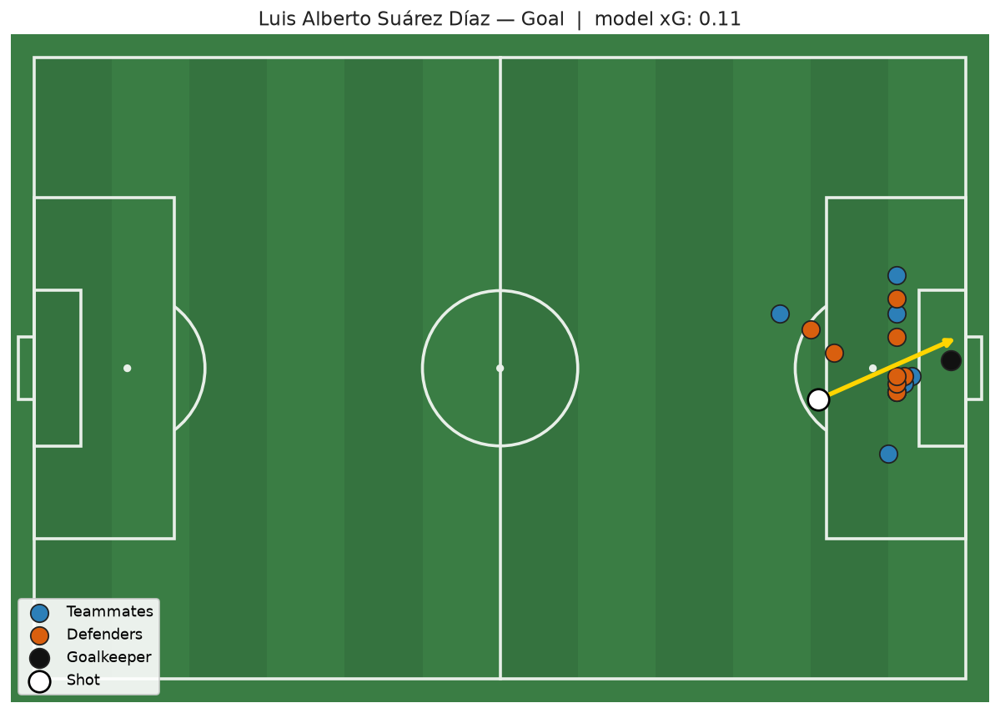
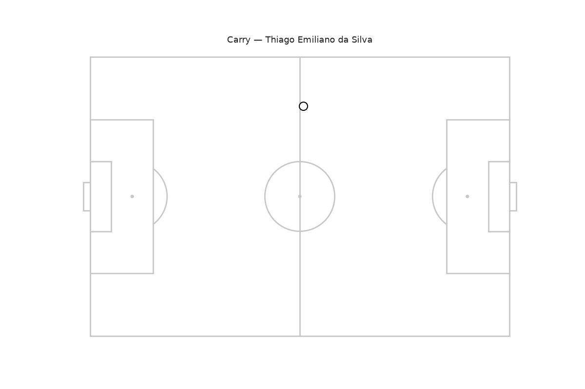
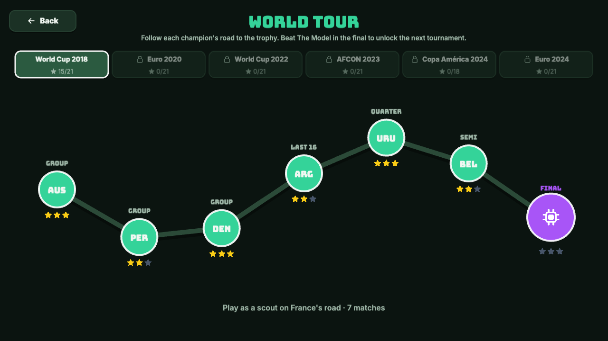
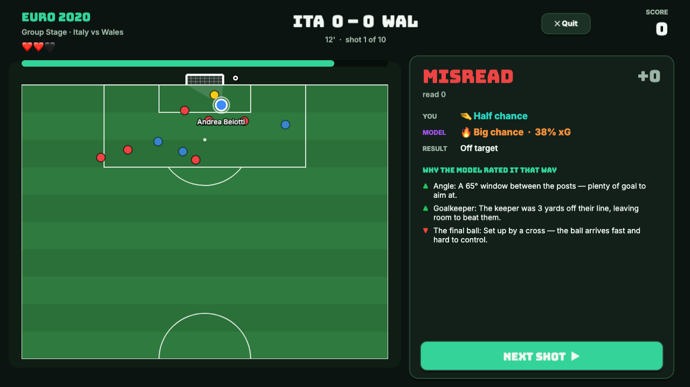
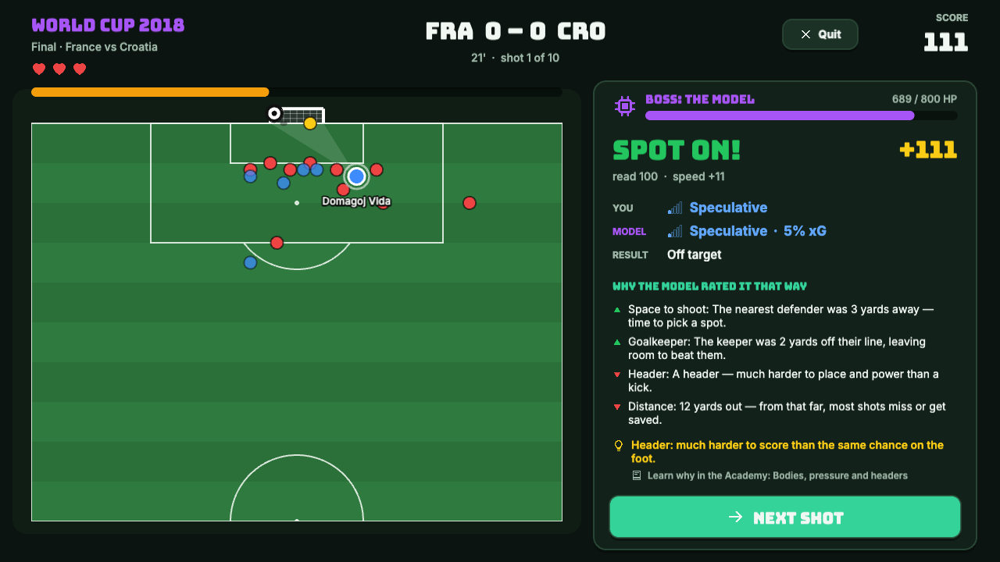
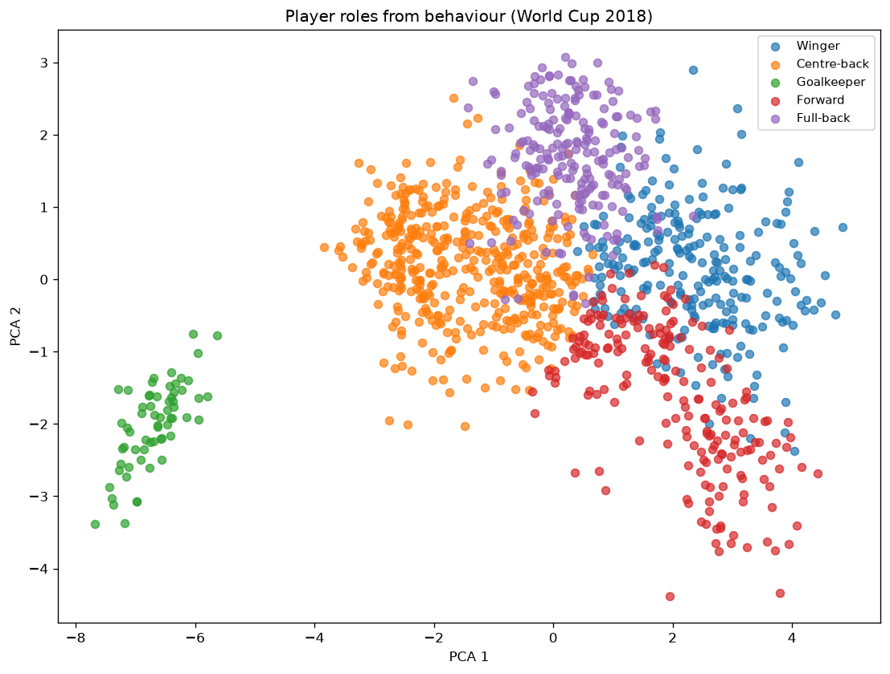

# PitchSense

An interactive tool that teaches football tactics and concepts (xG, pressing, offside, formations) by replaying real match data as animations, asking you to predict outcomes, and comparing your guess against a trained machine-learning model — with difficulty that adapts to your weak areas.

Unlike a typical xG dashboard, the whole point here is a real pipeline: **real match data → trained ML models → animated replay → interactive quiz → adaptive personalization.** The predictions come from models trained on data, not from an LLM pretending to be a football expert.

## Problem

"How likely was that shot to score?" is something even experienced fans disagree on. Expected Goals (xG) answers it with data: given where a shot was taken and what was happening around it, what share of similar shots historically became goals? PitchSense trains that model and then uses it as a yardstick to help a learner build intuition.

## Data

- **Source:** [StatsBomb Open Data](https://github.com/statsbomb/open-data) — free, public, real professional match events.
- **International tournaments (every model):** six men's national-team
  tournaments — FIFA World Cup 2018 and 2022, UEFA Euro 2020 and 2024, Copa
  América 2024 and AFCON 2023 — **314 matches**. All have full event data and shot
  freeze-frames. They feed every model and are the only shots the quiz shows.
  Configured in `COMPETITIONS` in `data.py`.
- **Club seasons (xG and PSxG training only):** the complete 2015/16 Premier
  League, La Liga, Serie A and Ligue 1 seasons — **1,517 matches, 37,888 shots**,
  every team in each league. The physics of a shot (distance, angle, bodies in the
  way) is the same in a league match as in a World Cup, so these add volume to the
  two shot models. They are kept out of player roles, tactics and ratings because
  those describe the players and teams *in the tournaments*. Pooling a player's
  2015/16 club season with their World Cup games would mix contexts, and the much
  larger club sample would swamp the tournament play. Configured in
  `CLUB_COMPETITIONS`. Other club seasons in the open data are mostly one team's
  matches (Barcelona, PSG, Leverkusen) and are left out so no one side dominates.
- **Metrics are international only.** Club shots only ever join the *training*
  side: the held-out test set and every cross-validation validation fold are drawn
  from tournament shots, so every reported number describes tournament football.
- Data is pulled on demand via `statsbombpy` and cached locally under `data/`
  (git-ignored). `python -m pitchsense.build_data` fetches every international
  match once and writes all the caches together. `python -m pitchsense.data club`
  fetches the club shots into `data/club_shots/`, one file per season, so an
  interrupted download resumes where it stopped. GitHub rate-limits a download of
  this size, and the fetch backs off and retries when it does.

## Approach (Phase 1 — baseline xG model)

For every shot we engineer features from the event and its freeze-frame (the snapshot of player positions at the moment of the shot):

| Feature | Meaning |
|---|---|
| `distance` | Distance from the shot to the centre of the goal |
| `angle` | Angle of the goal mouth visible from the shot location (wider = easier) |
| `defenders_in_cone` | Opponents inside the triangle between the shot and the two goal posts |
| `nearest_defender_dist` | Distance to the closest opponent outfielder — how much space the shooter had |
| `defenders_behind_ball` | Opponent outfielders goal-side of the shot (between ball and goal line) |
| `keeper_dist_to_goal` | How far the goalkeeper was off their line |
| `keeper_dist_to_ball` | Distance from the keeper to the shot — small values are near one-on-ones |
| `keeper_in_cone` | Whether the keeper is inside the shot cone, guarding the direct lane |
| `defenders_in_lane` | Opponents on the straight line from the ball to the goal centre |
| `is_header` | Headed shot |
| `is_first_time` | Struck first time, without a touch to control |
| `is_one_on_one` | One-on-one against the keeper |
| `under_pressure` | A defender was closing the shooter down |
| `from_open_play` | Regular open play vs. a set-piece pattern |
| `assist_cross` | The assisting pass was a cross |
| `assist_cutback` | The assisting pass was a cutback |
| `assist_through_ball` | The assisting pass was a through ball |

The four freeze-frame features read the snapshot of every tracked player at the
instant of the shot: the goalkeeper (found by position name) gives the two keeper
distances, and the opponents give the nearest-defender and defenders-behind-ball
counts. When a shot has no freeze-frame these default sensibly (open space, keeper
on its line). The assist features are joined from the assisting pass event via
each shot's `shot_key_pass_id`.

**Target:** whether the shot was a goal. Penalties are excluded — they score far more often than open play and would distort the model.

**Models:** two are trained and compared — Logistic Regression (standardized
features) and XGBoost. Each one's hyperparameters are tuned by 5-fold
cross-validated search on the training data (a grid over the linear model's
regularisation strength, a 40-point randomized search over the XGBoost tree
parameters), optimising log loss because xG needs to be *calibrated*, not just
correctly ranked. The pipeline serves whichever tuned model has the lower
cross-validated log loss; it is not hardcoded.

## Results

Each model is reported two ways: **cross-validated** metrics (mean ± std over the
five training folds, which show stability) and a **held-out test set** never
touched during the search (an unbiased final number). Both are measured on
international shots only.

Trained on 7,509 international open-play shots (8.9% goal rate) plus 37,488 club
shots used only for training, 17 features:

| Model | CV log loss | CV ROC AUC | Test log loss | Test ROC AUC |
|---|--:|--:|--:|--:|
| Logistic Regression | 0.254 ± 0.005 | 0.780 ± 0.010 | 0.245 | 0.809 |
| **XGBoost** (served) | **0.247 ± 0.008** | **0.791 ± 0.017** | **0.237** | **0.820** |

**More data is what finally separated the two models.** On the tournament shots
alone the two were tied (CV log loss 0.253 vs 0.254, CV AUC 0.773 vs 0.775). The
club seasons multiply the training set about six-fold, and XGBoost turns that
into a clear lead while logistic regression barely moves. A linear model has
little more to learn from extra shots of the same kind; a tree can use the volume
to fit interactions such as distance × angle. The pipeline therefore now serves
XGBoost (the choice is still made by CV log loss, not hardcoded). The single
random test split happens to be an easy one (test AUC above CV AUC for both
models), so the leave-one-tournament-out numbers below are the fairer estimate.

How the pre-shot model got here:

| Step | Data | Served model | Held-out-tournament AUC |
|---|---|---|--:|
| Baseline features | 4 tournaments | Logistic Regression | ~0.78 |
| + freeze-frame features | 4 tournaments | Logistic Regression | 0.780 (XGBoost 0.787) |
| + Copa América, AFCON | 6 tournaments | XGBoost (by a hair) | 0.786 |
| + 2015/16 club seasons | 6 tournaments + 4 leagues | **XGBoost** | **0.795** |

The served model stays well calibrated: across ten probability buckets its
predictions track the actual goal rate closely (top bucket predicts 0.40, actual
0.38). StatsBomb's own production xG reaches ~0.78–0.80 AUC using still more
features, so this model sits in that range.

Both tuned models are saved (`models/xg_logreg.joblib`, `models/xg_xgboost.joblib`),
the served model is copied to `models/xg_baseline.joblib`, and the full comparison
— best hyperparameters, per-fold CV metrics, test metrics, and the number of club
training shots — is written to `models/xg_metrics.json` on every training run.
`python -m pitchsense.train --no-club` trains on the tournaments alone, for
comparison.

## Post-shot xG (PSxG)

The model above is *pre-shot* xG: it rates the chance from the situation before
the ball is struck. A natural companion question is "given the shot was taken and
placed **there**, how likely was it to score?" — **post-shot** xG (PSxG), which
measures shot execution and goalkeeping. The difference is one feature: where the
ball ended up. `shot_end_location` gives the ball's lateral position in the goal
and its height, which become `placement_from_center` and `placement_height`.

That placement is the *result* of the shot, not a condition known before it, so
it is deliberately kept **out** of the served xG model — folding it in would be
target leakage and stop the model being a real "expected goals". Instead it lives
in a separate model (`postshot.py`) that reuses the pre-shot features and adds the
two placement features on top. By convention PSxG is defined only over **on-target**
shots (goals and saves — the ones a keeper had to deal with), since an off-target
shot never had a placement that could score. That leaves 2,325 international
shots at a 28.7% goal rate, plus 12,394 on-target club shots for training only.
The same cross-validated search as the pre-shot model is reused.

| Model | CV log loss | CV ROC AUC | Test log loss | Test ROC AUC |
|---|--:|--:|--:|--:|
| Logistic Regression | 0.503 ± 0.014 | 0.764 ± 0.016 | 0.507 | 0.768 |
| **XGBoost** (served) | **0.396 ± 0.013** | **0.872 ± 0.009** | **0.383** | **0.882** |

**This is where the gradient-boosted tree finally pulls clear of the linear
model** — by a wide margin (0.872 vs 0.764 CV AUC), not the coin-flip of the
pre-shot task. Placement is strongly non-linear: a shot into either top corner is
lethal, one straight at the keeper is not, and the value depends on lateral
position and height *together*. A logistic regression, additive in its features,
cannot represent that "corner" interaction; a tree carves it out naturally. So on
this task the pipeline selects XGBoost as the served post-shot model — the answer
to the earlier open question of when the tree would earn its place. The model and
metrics are saved to `models/psxg_*.joblib` and `models/psxg_metrics.json`, and
the quiz surfaces it: on a revealed on-target shot it shows the post-shot xG next
to the pre-shot xG, so a struck-well goal reads as a good finish on top of a good
chance.

## Does it generalise to an unseen tournament?

A random train/test split lets shots from every tournament appear in both halves,
so a model could quietly learn tournament-specific quirks and still score well. A
stricter test holds out one whole tournament, tunes and trains on the other five
(plus the club seasons, which are never held out), and evaluates on the unseen
one — repeated with each tournament held out in turn (leave-one-tournament-out).
The search is re-run inside each fold, validating on tournament shots only, so the
held-out tournament never influences model selection. It runs twice, with and
without the club data, to measure what the club data is actually worth.

Pre-shot xG, ROC AUC on the held-out tournament:

| Held out → | WC 2018 | WC 2022 | Euro 2020 | Euro 2024 | Copa 2024 | AFCON 2023 | Mean |
|---|--:|--:|--:|--:|--:|--:|--:|
| Logistic Regression, tournaments only | 0.772 | 0.805 | 0.782 | 0.763 | 0.781 | 0.781 | 0.781 |
| Logistic Regression, + club | 0.775 | 0.807 | 0.787 | 0.767 | 0.776 | 0.791 | 0.784 |
| XGBoost, tournaments only | 0.777 | 0.807 | 0.797 | 0.757 | 0.788 | 0.791 | 0.786 |
| **XGBoost, + club** | **0.786** | **0.815** | **0.797** | **0.782** | 0.786 | **0.808** | **0.795** |

Adding the club seasons lifts XGBoost from 0.786 to **0.795** mean AUC and cuts
its mean held-out log loss from 0.2495 to 0.2448. It improves on four of the six
tournaments, ties on Euro 2020 and is a hair lower on Copa América (0.786 vs
0.788). The biggest gain is on Euro 2024 (+0.025), previously the hardest
tournament to predict. Logistic regression gains only +0.003, as you would expect
from a linear model that was already saturated. The club data helps because
league shots *do* transfer to tournaments; if they did not, adding 37,000 of them
would have hurt here.

The **post-shot model** stands up to the same test on its on-target shots:

| Held out → | WC 2018 | WC 2022 | Euro 2020 | Euro 2024 | Copa 2024 | AFCON 2023 | Mean |
|---|--:|--:|--:|--:|--:|--:|--:|
| Logistic Regression, + club | 0.749 | 0.787 | 0.764 | 0.755 | 0.728 | 0.778 | 0.760 |
| XGBoost, tournaments only | 0.784 | 0.878 | 0.894 | 0.872 | 0.866 | 0.889 | 0.864 |
| **XGBoost, + club** | 0.763 | **0.892** | **0.898** | **0.883** | **0.896** | **0.903** | **0.872** |

Club data lifts the post-shot XGBoost from 0.864 to **0.872** mean AUC (log loss
0.410 → 0.404). World Cup 2018 is the exception: it drops from 0.784 to 0.763.
That tournament has the weakest post-shot scores either way, so its placement data
may differ from the others, but this has not been investigated. XGBoost still
beats the linear model on every held-out tournament, confirming that the
top-corner non-linearity it exploits is a real, transferable effect.

Neither evaluation changes a served model. Each writes a report to
`models/xg_generalisation.json` / `models/psxg_generalisation.json` (with club
data) and `*_intl_only.json` (without). Run them with
`python -m pitchsense.generalisation [psxg] [--no-club]`.

## Project layout

```
src/pitchsense/
  data.py       # competition config + load & cache StatsBomb shots (international + club)
  build_data.py # single-pass fetch that builds all three caches at once
  features.py   # pitch geometry + feature engineering (pure, tested)
  train.py      # tune, cross-validate, evaluate, and save the pre-shot xG model
  postshot.py   # post-shot xG (PSxG): adds shot-placement features
  generalisation.py # leave-one-tournament-out test of xG transfer
  pitch.py      # draw a football pitch in StatsBomb coordinates
  viz.py        # render a shot + its freeze-frame, annotated with model xG
  sequences.py  # build an interpolated ball track from a possession
  animate.py    # render a possession as an animated replay (GIF)
  quiz.py       # scoring, Beginner chance bands, and explanation for the quiz
  explain.py    # per-shot "why" from the linear model's feature contributions
  matches.py    # match context + player display names for each shot's story
  sandbox.py    # build a made-up chance and score it through the real pipeline
  lessons.py    # bite-sized lessons: explain, spot the better chance, practise
  concepts.py   # concept tagging, per-concept progress, adaptive shot selection
  leaderboard.py # persistent local high-score table (pure, tested)
  possessions.py # possession -> tactical feature vector (pure, tested)
  tactics.py    # cluster possessions into tactical patterns (k-means)
  players.py    # player -> behavioural feature vector (pure, tested)
  roles.py      # cluster players into roles (k-means + PCA role map)
  ratings.py    # per-player effectiveness & discipline, percentiled within role
  export_game.py # bake shots, xG, reasons, career and puzzles into JSON for the game
streamlit_app.py  # the app: lessons, quiz, sandbox, explorers
game/           # the browser game (Phaser 3 + TypeScript + Vite), see "The game"
tests/          # unit tests for the geometry, features, and rendering
data/           # cached raw data (git-ignored)
models/         # trained models + metrics (git-ignored)
docs/           # rendered example figures
```

## Visualization

Any shot can be drawn on a pitch with its freeze-frame — the shooter, teammates,
defenders, and goalkeeper as StatsBomb recorded them at the moment of the shot —
with the ball's path and the model's xG in the title. This is the visual layer
the interactive quiz will later pause on.



The example above is a Luis Suárez goal the model rates at just 0.01 xG: a tight
chance struck through a crowded box (seven defenders between the ball and goal).
Regenerate it with `python -m pitchsense.viz`.

### Animated replay

A whole possession can be replayed as a moving ball. StatsBomb records discrete
events rather than continuous tracking, so the ball is walked through the
possession's on-ball actions (passes, carries, the shot) and interpolated
between their start and end locations, with a trail and a caption naming the
current action and player.



The replay above is a full goal build-up. Regenerate it with
`python -m pitchsense.animate`. When the tactical classifier (below) has been
trained, the replay is captioned with the pattern it detects for the possession
— the example above reads *Counter-attack / direct*.

## Interactive app

The pieces above come together in a Streamlit app built to make learning to read
a chance *fun*: real shots with real stories, short lessons, and a sandbox to
play with the model directly.

```bash
streamlit run streamlit_app.py
```

A **Beginner / Expert** toggle in the sidebar changes how you answer, how you are
scored, and how much technical detail you see. Beginners *name* the chance
(🎲 Speculative · 🤏 Half chance · 👍 Good chance · 🔥 Big chance · 😱 Sitter) and
score by matching the model's band. That gives consistent feedback, where scoring
against the noisy 0/1 outcome would punish a correctly read long shot that happened
to fly in. Experts give an exact percentage, scored with the Brier rule against the
real outcome and compared with the model's own score. The bands follow the served
model's xG distribution and each carries a representative probability.

**🎓 Learn**: eight two-minute lessons (what xG is, distance, angle, bodies in the
way, headers, one-on-ones, pressure, the final ball). Each lesson explains one idea
in plain language, then asks you to **spot the better chance** between two
situations built in the sandbox, which the model then rates. It finishes with three
real shots tagged with that concept. Every lesson also quotes the real goal rate for
its concept from the data.

**🎯 Shot quiz**: free play over every shot. Each shot comes with its story: the
player (by the name fans know, e.g. *Neymar* rather than his full registered name),
both teams, the tournament and stage, and the minute. The final score stays hidden
until the reveal so it can't give the answer away. The reveal shows the outcome, the
model's rating as "N in 100 shots like this go in", and **why the model rated it
that way**. The served XGBoost model's log-odds split exactly into per-feature
contributions (its TreeSHAP values; a linear model's coefficients work the same
way if one is served). These are grouped into
football ideas (distance, angle, bodies in the way, the keeper, …) and shown as
plain sentences (`explain.py`). A reality check reports how often shots in that band
actually scored, and on-target shots also show post-shot xG, the quality of the
finish next to the quality of the chance.

**🧪 Be the striker**: build a chance (distance, position across the pitch,
defenders in the way, how tight the marking is, where the keeper is, header, pressure,
the pass before) and watch the real model rate it live. You can also switch on an
**xG map** that shows how the chance changes as you move. Each scenario becomes a
synthetic StatsBomb-shaped shot and goes through the same `build_feature_frame` the
model was trained on, so the sandbox can never drift from the real features
(`sandbox.py`).

**🧭 How teams attack** and **🧑‍🤝‍🧑 Player roles**: the tactical-pattern and
player-role models, led by plain-language descriptions and the interactive parts
(design a move and see what the model calls it; look up whether a player plays their
listed position). The cluster tables, silhouette scores and PCA map sit in an
"Under the hood" expander that opens by default in Expert mode.

**🔧 Under the hood**: the pipeline in brief and the live cross-validated and
held-out metrics for both xG models.

The explorer tabs degrade gracefully to a "train this model first" hint if a model
has not been built, and match context falls back to team and minute if
`data/matches.parquet` is absent (`python -m pitchsense.matches` builds it).

### Adaptive practice

Every shot is tagged with the football concepts it exercises — a header, a
long-range effort, a one-on-one, a chance struck through a crowded box — derived
from its features. The quiz keeps a running average of your points per concept
and biases which shot comes next toward the concepts you estimate worst,
alongside an exploration nudge so unseen concepts still surface early. A
"Where you stand" panel shows your per-concept scores, weakest first, so the
practice concentrates where your intuition is furthest from the model's. The
tagging, progress tracking, and weighted selection are pure functions in
`concepts.py`, kept free of any UI so they can be unit tested.

### Leaderboard

Sessions can be saved to a persistent local leaderboard. Because a session can
be any length, players are ranked by their **average points per round** rather
than a raw total, and must complete at least five rounds to qualify so a single
lucky guess cannot top the board. Each entry also records how many points per
round the player beat the *model's* own estimate by, which doubles as the
tie-break. There are no accounts — the board is a single JSON file on disk
(`data/leaderboard.json`, git-ignored), so it is a local scoreboard rather than
an online one. The store, ranking, and qualification rules live as pure functions
in `leaderboard.py` and are unit tested against a temporary file; the quiz shows
the top ten and reveals a save form once you have qualified. The leaderboard lives in Expert mode,
where every score uses the same Brier scale against the real outcome.

## The game

`game/` turns the same shots and models into a real browser game: PitchSense:
Scout Career, built with Phaser 3, TypeScript and Vite. The Streamlit app is
where you learn and explore; the game gives you a reason to come back. It has
no backend. `python -m pitchsense.export_game` bakes everything the game needs
into static JSON, so every probability it shows came from a model trained here.



**Core loop.** You see the frozen moment a real shot was struck: the shooter,
teammates, defenders and keeper slide into place. You have a few seconds to
call the chance band (keys 1–5). The model then locks in its own call, the
ball flies to where the shot really finished (top-down, so it grows as it
rises), and a GOAL / SAVED / BLOCKED stamp lands. The reveal card shows your
call against the model's xG, post-shot xG if it was on target, and the model's
own reasons from `explain.reasons`.



**Scoring.** The base points are the Streamlit quiz's beginner scoring (100 for
the model's band, 50 for a neighbour). On top of that you get up to +25 for
answering fast, and a combo multiplier for consecutive exact reads (×1.25, ×1.5,
×2). Stars only count base points, so they measure reading, not reflexes.

**Modes**

| Mode | What it is |
|---|---|
| 🏆 World Tour | Career mode. Each of the six tournaments is played along the eventual champion's road: three group games, the knockouts and the final (`export_game.build_career`). A match is up to 10 of its real shots in minute order, every goal included, with a live scoreboard that ticks over (penalties too). You have 3 hearts, and a read two bands off costs one. 1–3 stars. |
| 🤖 Boss: The Model | Every final is a boss fight. The Model has 80 HP per shot, your points deal damage, you get 7 s per shot, and a misread lets it strike back. Win to lift the trophy and unlock the next tournament. |
| 📅 Daily Challenge | 10 shots seeded by the date, two from every chance band, the same for everyone. One scored attempt a day, a streak, and a Wordle-style 🟩🟨🟥 result to copy. |
| ⏱️ Rapid Fire | 60 seconds of endless shots. Exact reads add 2 s and close reads 1 s. Shots are chosen by the same weak-concept weighting as `concepts.pick_adaptive`, ported to TypeScript. |
| 🎯 Striker's Instinct | Puzzles. You carry the ball up to N yards into a fixed defence and shoot from the spot you think the model rates highest. Then the model's xG for every reachable spot is revealed as a heatmap (`export_game.build_puzzle`). |



**The Academy.** The game assumes you can read a football picture, so it
teaches you to first. 17 short lessons in four modules take a newcomer from
zero: the pitch, the rules (restarts, fouls, offside), positions and
formations, how attacks are built (crosses, cutbacks, through balls, counters,
set pieces), and finally xG, the chance bands and post-shot xG. Each lesson
steps through an animated diagram drawn on the same pitch the game uses, ends
with a check question, and links out to the IFAB Laws of the Game, Wikipedia
and StatsBomb for more. First-time players are offered the Academy before they
play. After every shot, the reveal points at the lesson behind the model's main
reason (`CONCEPT_NOTES` and `REASON_LESSONS` in `game/src/academy/curriculum.ts`),
so playing and learning feed each other. The curriculum is plain data and is
unit tested: valid answers, on-pitch coordinates, and a lesson for every tag.

**Meta-game.** XP, scout levels and ranks (Sunday League Scout → Legendary
Scout), coins, 18 achievements, a trophy cabinet, a per-concept scouting report,
and a shop with pitch themes (Floodlit Night, Snow Day, Neon Arcade, Golden
Final) and ball skins. The save lives in `localStorage` and is merged over
defaults on load, so an old save never breaks a new build. Every sound is
synthesised with WebAudio, so the game ships no audio files.

**Two things the export guards against.**
- **Puzzle keepers track the ball.** A keeper frozen in place leaves open goals
  the model never saw in training, and it rates them absurdly high. Puzzle
  keepers are placed with the sandbox's `keeper_point` for every spot instead.
- **Puzzles only let you carry the ball forward or sideways.** If you drop deep
  enough, every defender ends up goal-side. The training data only shows that
  shape as a counter-attack, so the model would rate a 40-yard punt as a real
  chance (`reachable_spots`).

**Layout.** Game rules live in `game/src/systems/` as pure TypeScript: scoring,
progression, career, adaptive selection, seeded RNG, achievements, the save and
cosmetics. They are unit tested with Vitest and know nothing about Phaser.
Rendering lives in `game/src/pitch/PitchView.ts`, which maps StatsBomb yards to
screen pixels and has a zoomable viewport. The canvas is drawn at the screen's
real resolution (`RES` in `ui/theme.ts`) so lines and text stay sharp, and every
icon is a line-drawn SVG from `ui/icons.ts`, tinted in place. The game uses no emoji. The screens are in
`game/src/scenes/`.

```bash
PYTHONPATH=src python -m pitchsense.export_game   # writes game/public/data/*.json
cd game && npm install
npm run dev     # play at http://localhost:5173
npm test        # Vitest: the game systems
npm run build   # static site in game/dist/
```

`.github/workflows/game.yml` runs the export from the committed caches and
models, tests and builds the game, and publishes it to GitHub Pages. The
exported JSON is git-ignored, so the game can never drift from the models. The
Streamlit sidebar links to the published game.

## Tactical pattern classifier

Beyond single shots, PitchSense classifies whole **possessions** by *how* the
ball was moved. StatsBomb has no ground-truth tactical labels, so this is
unsupervised: each possession is reduced to shape-and-tempo features and the
possessions are grouped with k-means, then the discovered clusters are named by
inspecting their centroids. The labels are an interpretation of the clusters,
not taught targets — the honest framing for an unsupervised model.

Per possession (`possessions.py`, pure and tested) we measure duration, number
of passes, how far and how directly it moved upfield (`net_forward`,
`directness`), how fast (`forward_speed`), its lateral spread, where it started,
and whether it ended in a shot. Possessions with fewer than three on-ball
actions are dropped as too short to carry a pattern.

Trained across all six tournaments (**40,027 possessions**, k=3, silhouette
**0.26**), the three clusters map cleanly onto the archetypes the project
targets:

| Pattern | Share | Passes | Duration | Upfield | Directness | Speed | Ends in shot |
|---|--:|--:|--:|--:|--:|--:|--:|
| **Counter-attack / direct** | 17,212 | 4.0 | 11.8s | 56.8y | 0.53 | 6.5 y/s | 12% |
| **Patient build-up** | 7,849 | 16.8 | 55.1s | 56.3y | 0.14 | 1.2 y/s | 22% |
| **Quick regain / transition** | 14,966 | 5.6 | 16.6s | 12.2y | 0.07 | 0.7 y/s | 12% |

The clusters are genuinely distinct and readable: counter-attacks are short,
fast, and strike straight at goal; build-ups string together ~18 patient passes
over ~57 seconds and produce the most shots; the third group starts highest up
the pitch and makes little further ground — balls won high and used quickly. The
profiles are essentially unchanged from the single-tournament version, which is
reassuring: the same tactical structure recurs at nearly 5× the scale, and adding
Copa América and AFCON did not shift it. The silhouette
of 0.26 is modest, as expected for real football possessions that overlap rather
than fall into clean islands; the value is reported so the k=3 choice can be
sanity-checked, and the cluster naming is a deterministic, unit-tested ranking of
the centroids rather than a hand-placed guess.

The model and a full cluster summary are saved to `models/tactics_kmeans.joblib`
and `models/tactics_metrics.json` on every training run, and the animated replay
is captioned with the pattern the classifier assigns to the possession being
shown.

## Player-role clustering

The same idea is applied to players: instead of trusting the position they are
listed at, PitchSense clusters players by *how they actually play*. Each player
(`players.py`, pure and tested) is described by scale-free behavioural features —
average position on the pitch, how much they roam, and the share of their actions
that are passes, carries, dribbles, shots, or defending, plus how forward and how
long they pass. Shares and averages rather than raw counts mean a player who
featured in six matches is comparable to one who featured in two without needing
exact minutes. The nominal position is deliberately **not** a clustering feature —
it is kept only to label and validate the clusters.

Features are standardised and clustered with k-means; the number of clusters is
chosen by silhouette, and PCA projects the space to two dimensions for the map
below. Trained across all six tournaments (**1,169 regular players**,
k chosen as **5**, silhouette **0.287**):

| Role cluster | Players | Position purity | Avg x | Width | Pass share | Def. share | Dribble |
|---|--:|--:|--:|--:|--:|--:|--:|
| Goalkeeper | 63 | 100% | 10.2 | 5.7 | 0.38 | 0.05 | 0.000 |
| Centre-back | 448 | 55% | 49.9 | 17.2 | 0.31 | 0.15 | 0.003 |
| Full-back | 206 | 90% | 59.6 | 29.1 | 0.32 | 0.17 | 0.007 |
| Winger | 245 | 39% | 73.7 | 23.7 | 0.23 | 0.17 | 0.020 |
| Forward | 207 | 39% | 70.0 | 19.2 | 0.21 | 0.24 | 0.010 |

Each cluster is named by the most common listed position of the players inside
it, and its **purity** — the share that actually hold that position — is reported
rather than hidden. Goalkeepers separate perfectly (a clean island in the map)
and full-backs are 90% pure because their width makes them behaviourally
distinct. The interesting result is the mixing: the "Centre-back" cluster also
absorbs 134 defensive and 53 central midfielders, because deep, narrow, pass-heavy
midfielders *play like* defenders; the more advanced midfielders land instead in
the winger and forward clusters. There is no clean standalone midfielder cluster
at k=5 — a genuine finding, not a bug: midfield is a spectrum, and behaviour
sorts those players by whether they lean defensive or attacking. The pattern is
unchanged from the single-tournament run at nearly 3× the players, and purity
edges up slightly with the larger sample.



The PCA map shows the same story spatially: goalkeepers sit far off on their own,
and the outfield roles form a continuous defence-to-attack gradient rather than
crisp islands, which is why the silhouette (0.287) is moderate. The model, PCA
projection, and full per-cluster position breakdown are saved to
`models/roles_kmeans.joblib` and `models/roles_metrics.json`. Regenerate
everything, including the map, with `python -m pitchsense.roles`.

## Player effectiveness & discipline

The role clusters say *how* a player plays. A second layer (`ratings.py`) scores
how *well* and how *cleanly* they play. It is kept out of the clustering on
purpose: adding quality and foul counts as k-means features would split each role
into "good" and "bad" versions of itself and blur the role labels. The style
features and clusters are the same as without it.

Each stat is converted to a **percentile among players of the same detected
role**, because raw numbers do not compare across roles: a centre-back's median
pass completion is 88% against 76% for a forward.

| Score | Built from | Direction |
|---|---|---|
| **Effectiveness** | pass completion, dribble success, tackle win rate, finishing (non-penalty goals − served-model xG, per shot) | higher = better |
| **Discipline** | fouls committed and card points (yellow 1, second yellow 2, red 3) per 100 actions | higher = cleaner |
| Fouls drawn | fouls won per 100 actions | context only, in neither score |

A stat a player has fewer than 10 attempts at (dribbles, tackles, shots) is
left out of their average rather than guessed. Coverage is 1,169 players for
pass completion, 316 for tackles, 240 for dribbles and 191 for finishing. The two
scores are close to independent (Spearman ρ = 0.13), so discipline is not just
effectiveness under another name. Rates are per 100 actions because the events
do not record minutes played.

These are transparent percentile scores, **not a trained model**: the data has
no ground-truth "effective player" label to learn from. Finishing uses the xG
model on shots it was partly trained on. With 37,000 club shots also in its
training set the in-sample bias is small, but it is not zero. The player lookup in the app
shows both scores next to the detected role, and the "Under the hood" expander
shows role medians. The full table goes to `data/player_ratings.parquet`, and
the report (coverage, stat correlations, top players) goes to
`models/ratings_metrics.json`.

## Setup

Requires Python 3.11+.

```bash
python -m venv .venv
.venv/Scripts/activate        # Windows
# source .venv/bin/activate   # macOS / Linux
pip install -r requirements.txt
```

## Run

```bash
# Fetch every match once and build all three data caches (slow, run first)
PYTHONPATH=src python -m pitchsense.build_data

# Fetch the 2015/16 club-season shots used to train the xG models (~1h, resumable)
PYTHONPATH=src python -m pitchsense.data club

# Train and evaluate the pre-shot xG model (uses the cache; fetches if absent;
# add --no-club to train on the tournaments alone)
PYTHONPATH=src python -m pitchsense.train

# Train the post-shot xG (PSxG) model, which adds shot-placement features
PYTHONPATH=src python -m pitchsense.postshot

# Leave-one-tournament-out generalisation report (xG, and PSxG with `psxg`;
# add --no-club for the tournaments-only comparison)
PYTHONPATH=src python -m pitchsense.generalisation
PYTHONPATH=src python -m pitchsense.generalisation psxg

# Render an example shot with its freeze-frame to docs/example_shot.png
PYTHONPATH=src python -m pitchsense.viz

# Render an animated replay of a goal build-up to docs/example_sequence.gif
PYTHONPATH=src python -m pitchsense.animate

# Cluster possessions into tactical patterns and print the cluster summary
PYTHONPATH=src python -m pitchsense.tactics

# Cluster players into roles, print the summary, and render docs/player_roles.png
PYTHONPATH=src python -m pitchsense.roles

# Score player effectiveness & discipline (needs the roles and xG models)
PYTHONPATH=src python -m pitchsense.ratings

# Launch the interactive quiz
streamlit run streamlit_app.py

# Export the game data, then play the browser game
PYTHONPATH=src python -m pitchsense.export_game
cd game && npm install && npm run dev

# Run the tests
pytest
```

## What's tested

- Pitch geometry: distance, shot angle (relative ordering and bounds), and the
  defenders-in-cone point-in-triangle logic, including teammate/opponent handling,
  missing freeze-frames, and numpy-array locations from the parquet cache.
- Freeze-frame features: nearest defender (closest opponent, keeper excluded, and
  the open-space default), defenders behind the ball (goal-side only), the two
  goalkeeper distances (found by position, with sensible defaults when absent), the
  keeper-in-cone and defenders-in-lane logic (point-in-triangle and point-to-segment
  geometry), including their assembly into the built feature frame.
- Post-shot xG: the placement features (lateral offset and height, from 2D or 3D
  end locations and the missing case) and the post-shot frame — that only on-target
  shots are kept and that the placement columns are added on top of the pre-shot set.
- Generalisation: the tournament labelling (mapping and dropping unmapped shots),
  the held-out split (the named tournament isolated to the test side), and the
  cross-tournament summary (means computed while the per-tournament detail is kept).
- Feature frame assembly: penalties dropped, goals labelled, header flag, and the
  assist-type features (present and defaulted-to-zero cases).
- Training helpers: the cross-validation summary (per-fold mean/std with the
  sign-flip for sklearn's negated log-loss and Brier scorers) and the search-space
  definitions (both models present, tuning the expected parameters).
- Rendering: the pitch has correct extent and markings, and freeze-frame players
  are grouped into teammates, defenders, and goalkeeper (including numpy-array
  locations and missing/incomplete entries).
- Sequence building: end-location selection by event type, waypoint merging of
  touching points, frame interpolation counts/endpoints, and filtering a
  possession to the team's on-ball actions.
- Quiz logic: Brier scoring (including clamping), the model-comparison verdict,
  and the explanation text.
- Adaptive practice: concept tagging (each threshold, the assist/situation flags,
  and the standard-chance fallback), progress accumulation and per-concept
  averages, weighting weak and unseen concepts above strong ones, and that the
  weighted shot selection is valid and biases toward the neediest shots.
- Tactical patterns: possession feature engineering (forward progress, duration,
  path length and directness, the same-second speed guard, opponent-touch and
  short-possession filtering, frame assembly and tagging) and the cluster
  labeller (relative ranking of centroids onto the archetypes, every cluster
  named once, centroid averaging). The replay's pattern caption degrades
  gracefully to nothing when the classifier has not been trained.
- Player roles: behavioural aggregation (action shares, forward-pass ratio,
  average pitch position, pooling raw counts across matches, the modal-position
  label, the min-events filter, missing-location handling) and the cluster
  labeller (dominant position group, purity, and trait-based disambiguation of
  clusters that share a group), plus that silhouette-based `choose_k` recovers a
  known number of separated blobs.
- Player ratings: pass/dribble/tackle/foul/card counting (unscored pass outcomes
  and aerial duels excluded, card points from fouls and bad behaviour), NaN for
  zero attempts, back-compat with older caches, finishing as goals above xG per
  shot, small-sample masking, within-role percentiles, and both composite scores.
- Leaderboard: entry construction (averages, model margin, blank-name and
  zero-round guards), the save/load round-trip and parent-directory creation,
  resilience to a missing or corrupt file, and the ranking rules (average first,
  model margin as tie-break, and the minimum-rounds qualification filter).

The bulk labellers that the explorer tabs rely on (`label_possessions`,
`assign_roles`) are unit tested with a stub clusterer, and `overall_means`
composes the seed possession from the saved metrics.

The Streamlit flow is checked end-to-end with Streamlit's AppTest harness as a
manual smoke test — the quiz (guessing, revealing, seeing pre- and post-shot xG,
next shot, and saving a qualifying score to the leaderboard) and both explorer
tabs (the tactical-pattern sliders driving a live classification, and the
player-role lookup). It needs the data caches and trained models present and so is
run by hand rather than in the pytest suite.

Not yet tested end-to-end: the live data fetch (it hits the network) is exercised
manually via `python -m pitchsense.train`.

## Known limitations

- The player, tactics and ratings models use international tournaments only.
  National-team knockout football is somewhat distinct from week-in week-out club
  play. The xG models also learn from club shots, but only from 2015/16: the open
  data has no complete recent league seasons, and the game has shifted since
  (more pressing, more cutbacks).
- The club data outweighs the tournament data about five to one in xG training.
  Held-out tournaments show this helps on average, but the shots are not
  reweighted, so the model's sense of a "typical" shot leans toward 2015/16
  league football.
- The freeze-frame is read for keeper position, defender spacing, and shooting
  lanes, but not exhaustively: defender velocities are simply not in the snapshot,
  and finer passing-lane geometry could still be mined. On the tournament data
  alone the pre-shot model had plateaued at ~0.79 AUC; more data, not more
  features, took it to 0.795.
- The served models train on a single random train/test split with a fixed seed.
  The leave-one-tournament-out test above shows this hides no generalisation gap
  for either the pre-shot or the post-shot model, but both are still single-split
  models — a nested-CV point estimate would carry tighter error bars.
- The tactical clusters are unsupervised and unlabelled by nature: their names
  are a reasonable reading of the centroids, not validated against coached
  ground truth, and the silhouette (0.26) reflects genuinely overlapping play.
- Player roles are likewise unsupervised: at k=5 midfield does not form its own
  cluster but splits across the defensive and attacking groups, so purity is
  moderate for the outfield clusters. Minutes played are not used; behaviour is
  normalised by action shares instead, which slightly flattens players with very
  few touches even after the min-events filter.

## Roadmap

**All six phases are complete** — the MVP (phases 1–4) and every stretch goal
(phases 5–6), plus extensions that went beyond the original plan (a post-shot xG
model and cross-tournament generalisation tests).

1. ✅ **Data + xG model** — Logistic Regression vs XGBoost, assist-type and
   freeze-frame features, multi-tournament data, cross-validated hyperparameter
   search, a leave-one-tournament-out generalisation test, plus a separate
   post-shot xG (PSxG) model with placement.
2. ✅ **Static pitch visualization** — shot + freeze-frame, annotated with xG.
3. ✅ **Animated replay** of a possession — interpolated ball track, captioned
   with its detected tactical pattern.
4. ✅ **Quiz layer** — estimate, compare to the model, explain the gap, and see
   pre- and post-shot xG side by side (Streamlit). **MVP complete.**
5. ✅ **Adaptive difficulty + per-concept progress tracking** — concept tagging,
   per-concept scoring, weak-area-biased shot selection, progress panel.
6. ✅ **Stretch** — **tactical pattern classifier** (k-means over possessions,
   labelled into build-up / counter-attack / regain, wired into the replay);
   **player-role clustering** (k-means + PCA over behavioural stats, labelled and
   purity-checked against nominal positions, with a role map); and a
   **leaderboard** (persistent local high-score table, ranked by average points
   per round with a model-beating tie-break). All three are also surfaced in the
   app's explorer tabs. **All stretch goals shipped.**
